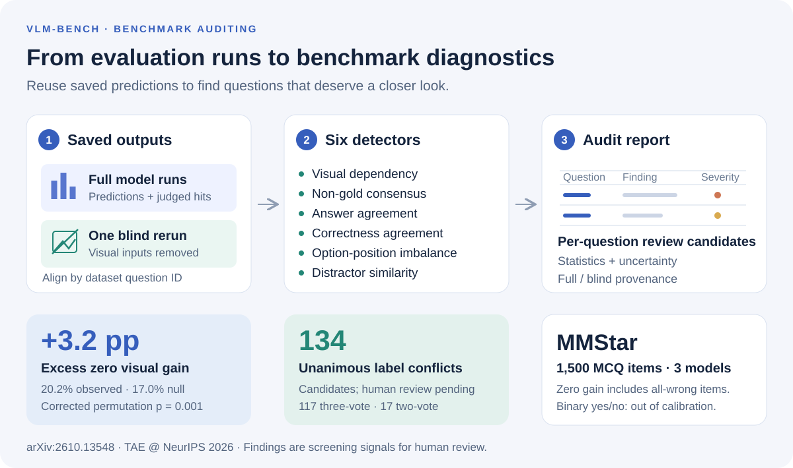

# Auditing VLM Benchmarks from Existing Evaluation Runs

**TAE (Trust-AI-Eval): Can We Trust AI Evaluation? · NeurIPS 2026 Workshop · Accepted poster · Non-archival**

[Paper on arXiv](https://arxiv.org/abs/2610.13548) ·
[OpenReview](https://openreview.net/forum?id=0RTvEQrBET) ·
[NeurIPS poster page](https://neurips.cc/virtual/2026/loc/sydney/178389) ·
[Reproduce the paper](docs/en/ReproducingPaper.md) ·
[Example report](audit_preliminary/mmstar_3models_gpt-4o-mini/significance_report.md)

Denis Degtiarev, Anna Gromova, Sergey Katkov, Artem Mikhailin,
Safina Mukhamedshina, Albert Nasybullin, Karina Shaikhutdinova, Artem Tuzov

Innopolis University



**Turn saved VLM predictions into a per-question benchmark audit.**
`vlm-bench` is a research fork of [VLMEvalKit](https://github.com/open-compass/VLMEvalKit).
It adds six detectors that examine saved predictions, correctness labels, and dataset
metadata. Visual-dependency analysis additionally needs one text-only rerun per model.
The audit itself is post-processing; it produces item-level findings, aggregate
statistics, and a manifest recording its inputs and configuration.

## What the paper found

The case study uses **MMStar, 1,500 multiple-choice questions, and three models**:
InternVL3-8B, Ristretto-3B, and gpt-5-nano.

| Measured quantity | Result | Interpretation |
|---|---:|---|
| Questions with equal pool-averaged accuracy in full and blind runs | 20.2% | Zero aggregate visual gain for this model pool; this includes questions answered incorrectly in both arms. |
| Item-matched permutation baseline | 17.0% | The raw zero-gain share needs a baseline. |
| Excess zero-gain share | **+3.2 pp** | Corrected permutation **p = 0.001**; concentrated in math and science & technology. |
| Unanimous non-gold answer conflicts | **134 candidates** | Every parseable model answer agrees on a non-gold option; human verification remains pending. |

Of the 134 candidates, 117 have three parseable answers and 17 have two.
Agreement does not establish that an annotation is wrong. Replacing the LLM judge
with exact matching leaves the main conclusions unchanged; all category differences
trace to one model's non-canonical outputs.

**Scope:** the headline evidence is from MMStar and this three-model pool. The
HallusionBench yes/no check falls out of calibration; binary formats need separate
calibration. Model agreement, visual gain, and distractor similarity are screening
signals, not a verified error rate or a universal benchmark-quality score.

## Explore an actual report

The [saved MMStar significance report](audit_preliminary/mmstar_3models_gpt-4o-mini/significance_report.md)
contains the measured results behind the paper, including leave-one-model-out pools,
category breakdowns, judge sensitivity, and threshold sweeps. For example:

| Model pool | Observed zero-gain share | Null mean | Excess |
|---|---:|---:|---:|
| All three models | 20.2% | 17.0% | +3.2 pp |
| Without InternVL3-8B | 27.9% | 24.1% | +3.7 pp |
| Without Ristretto-3B | 25.5% | 21.9% | +3.6 pp |
| Without gpt-5-nano | 34.4% | 26.7% | +7.7 pp |

The [archived item-finding digest](audit_preliminary/mmstar_3models_gpt-4o-mini/benchmark_audit_report.md)
shows what a detector report looks like. Its counts can include multiple detectors
and both evaluation arms for the same question; they are not counts of verified defects.
It predates the release's export fixes and is kept as an archival example.

**Artifact availability:** the source full/blind prediction files are included under
`paper-inputs/`. The manuscript, scripts, figures, and saved Markdown reports are also
available. [Reproduction instructions](docs/en/ReproducingPaper.md) document the input
layout and commands to recompute the statistics.

## Quickstart: audit your own evaluation runs

For reading the saved reports, no installation is needed. Running model inference
uses VLMEvalKit's model-specific dependencies and appropriate GPU/API access.
See the [toolkit setup guide](docs/en/Quickstart.md).

```bash
git clone https://github.com/avos-rnd/vlm-bench.git
cd vlm-bench
git checkout arxiv-v1
python -m pip install -e .
```

Run a small model pool on MMStar, then audit its saved full/blind artifacts:

```bash
# With images. For API judging, configure OPENAI_API_KEY in your environment.
python run.py --data MMStar --model InternVL3-8B Ristretto-3B \
  --mode all --reuse --judge gpt-4o-mini --work-dir outputs

# Additional text-only runs; the full and blind files coexist.
python run.py --data MMStar --model InternVL3-8B Ristretto-3B \
  --mode all --reuse --blind --judge gpt-4o-mini --work-dir outputs

# Post-processing only: reuse those saved results.
python run.py --mode bench_eval --data MMStar \
  --model InternVL3-8B Ristretto-3B --detectors all --work-dir outputs
```

This two-model example demonstrates the workflow; reproducing the paper requires
its original three-model inputs, generation settings, and judge outputs.

Under `outputs/`, inspect:

- `reports/benchmark_audit_report.md`: human-readable overview.
- `reports/aggregated_findings.json`: findings grouped by detector, severity, and question ID.
- `reports/<detector>.json`: detector statistics and public `findings` fields.
- `reports/<detector>/`: per-question exports, with full/blind provenance where applicable.
- `bench_quality_report.json`: input paths, aligned question count, commit, and CLI configuration.

Re-running aggregation does not count canonical reports and their side exports twice.
Detector scores are heuristic diagnostics; the paper's validated claims use explicit
null comparisons, uncertainty intervals, and model-pool sensitivity.

## The six detectors

| Detector | Reads | Reports |
|---|---|---|
| `visual_dependency` | Full and blind correctness | Per-question visual-gain categories. |
| `consensus_error` | Raw predictions and gold labels | Non-gold consensus candidates; unparseable answers do not vote. |
| `fleiss_kappa_agreement` | Raw predictions | Inter-model answer agreement and low-agreement items. |
| `correctness_agreement` | Correctness labels | Item difficulty and correctness agreement. |
| `answer_options_distribution` | Dataset annotations | Correct-option position imbalance. |
| `distractor_similarity` | Answer-option text | Duplicate or semantically similar distractors. |

Consensus and raw-answer agreement do not use an LLM judge. Visual-gain and
correctness analysis can use judged correctness or the paper's exact-matching arm.
The option-similarity backend and thresholds affect its findings. The detectors use
dataset question IDs to align results and identify items.
[Full protocol and limitations](docs/en/BenchmarkAudit.md).

## Reproduce the paper and run tests

The paper-statistics scripts and audit tests can run on CPU without installing the
model stack. With **Python 3.11**:

```bash
python -m pip install -r requirements/audit.txt
python -m pytest tests/test_detectors.py tests/test_bench_eval_pipeline.py tests/test_audit_reporting.py tests/test_paper_reproduction.py -q
python scripts/reproduce_paper.py --help
```

[ReproducingPaper.md](docs/en/ReproducingPaper.md) specifies artifact layout,
checksums, exact commands, and expected headline results. `scripts/reproduce_paper.py`
computes the statistics from supplied evaluation files and checks them against the
published values; add `--figures` to regenerate the statistical figures.

## Repository map

| Path | Contents |
|---|---|
| `vlmeval/detector/`, `vlmeval/bench_eval.py`, `vlmeval/reporting/` | Audit logic, orchestration, and report aggregation. |
| `scripts/audit_significance.py`, `scripts/audit_paper_figures.py` | Paper statistics and figures. |
| `scripts/reproduce_paper.py` | Input validation, provenance, and paper-result checks. |
| `audit_preliminary/` | Archived measured reports and unfilled annotation templates. |
| `paper/` | Camera-ready manuscript, bibliography, and figures. |
| `docs/en/ReproducingPaper.md`, `docs/en/BenchmarkAudit.md` | Reproduction guide and detector protocol. |
| `tests/` | Audit regression tests and inherited toolkit tests. |

Other evaluation infrastructure is inherited from VLMEvalKit. Historical experiment
plans are retained under `docs/`; they do not describe the current release protocol.
See [CONTRIBUTING.md](CONTRIBUTING.md) for validation and commit conventions.

## Citation

If you use the audit layer or the paper's findings, please cite:

```bibtex
@misc{degtiarev2026auditing,
  title={Auditing VLM Benchmarks from Existing Evaluation Runs},
  author={Denis Degtiarev and Anna Gromova and Sergey Katkov and Artem Mikhailin and Safina Mukhamedshina and Albert Nasybullin and Karina Shaikhutdinova and Artem Tuzov},
  year={2026},
  eprint={2610.13548},
  archivePrefix={arXiv},
  primaryClass={cs.CV},
  doi={10.48550/arXiv.2610.13548},
  url={https://arxiv.org/abs/2610.13548}
}
```

If you also use the underlying evaluation toolkit, cite
[VLMEvalKit](https://github.com/open-compass/VLMEvalKit#citation):

```bibtex
@inproceedings{duan2024vlmevalkit,
  title={Vlmevalkit: An open-source toolkit for evaluating large multi-modality models},
  author={Duan, Haodong and Yang, Junming and Qiao, Yuxuan and Fang, Xinyu and Chen, Lin and Liu, Yuan and Dong, Xiaoyi and Zang, Yuhang and Zhang, Pan and Wang, Jiaqi and others},
  booktitle={Proceedings of the 32nd ACM International Conference on Multimedia},
  pages={11198--11201},
  year={2024}
}
```

## License and provenance

Code: [Apache-2.0](LICENSE), inherited from VLMEvalKit. The manuscript is available
under the license listed on its [arXiv record](https://arxiv.org/abs/2610.13548).
The original toolkit history is retained. The audit layer is additive; one deliberate
change enables SSL certificate verification by default
(`VLMEVAL_INSECURE_SSL=1` restores the upstream behavior for broken mirrors).
